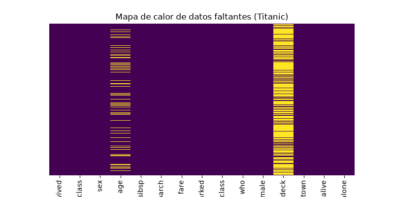
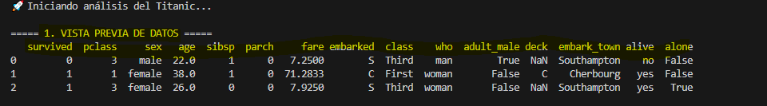
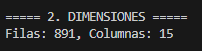
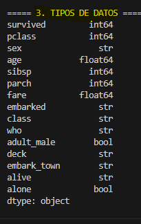
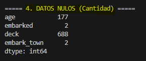
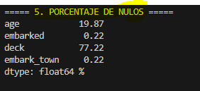
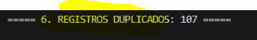
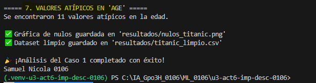

## | 🚨 Problema | 📝 Descripción | 💡 Ejemplo |
| :--- | :--- | :--- |
| **Datos nulos** | Información que no está registrada o es desconocida. | El campo "Edad" está vacío. |
| **Duplicados** | Registros idénticos repetidos, lo que sesga el modelo. | Dos filas con el mismo ID y datos. |
| **Tipos incorrectos** | Datos almacenados con un formato inadecuado. | La edad guardada como texto `"25"` en lugar de número `25`. |
| **Valores atípicos** | Valores extremos que se alejan del comportamiento habitual. | Una edad registrada como `250` años. |

> 💬 **Pregunta para iniciar la clase:**  

## Titanic imagen

## Titanic datos

## vista previa de datos

## Dimensioes

## Tipos de datos

## Datos Nulos

## Porcentajes Nulos

## Registrados Duplicados

##  VALORES ATÍPICOS EN 'AGE'
